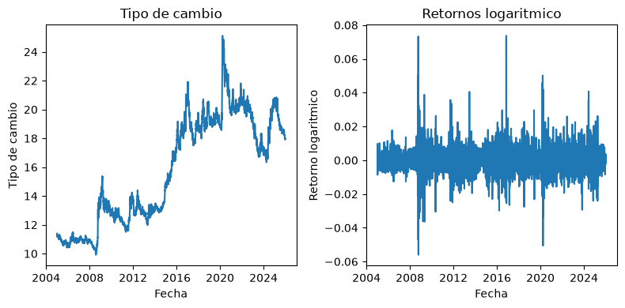
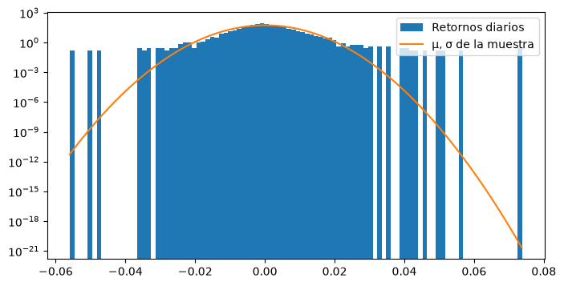
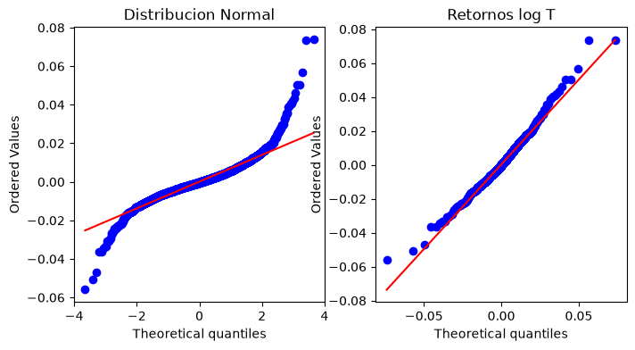
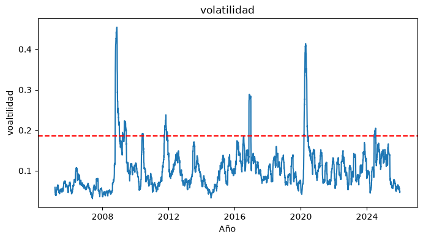
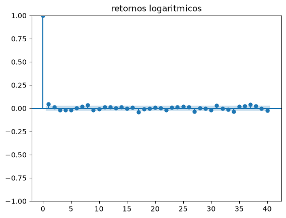
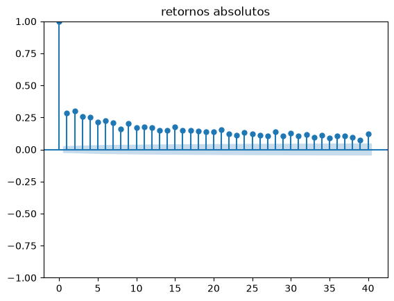

# Distribución de los retornos del peso mexicano (USD/MXN)

**Pregunta:** ¿los retornos diarios del peso siguen una distribución normal, y en qué momentos fue más volátil?

**Respuesta corta:** no son normales. Tienen colas mucho más pesadas de lo que una normal permite, y esa no normalidad se explica en buena parte porque la volatilidad cambia con el tiempo y se agrupa en episodios (2008-2009, 2016, 2020, 2024). Una t de Student con ~3.5 grados de libertad describe los retornos mucho mejor que la normal.

## Datos

- **Fuente:** Banxico (SIE), tipo de cambio FIX en pesos por dólar.
- **Periodo:** 3 de enero de 2005 al 31 de diciembre de 2025.
- **Tamaño:** 5,283 cotizaciones diarias y 5,282 retornos.
- **Retornos:** logarítmicos diarios, `ln(P_t) - ln(P_{t-1})`.

## Cómo correrlo

1. Descarga la serie desde el portal del SIE de Banxico y guárdala en `data/tipoCambio.xls`.
2. Ajusta la ruta de lectura en la primera celda del notebook.
3. Instala las dependencias: `pandas`, `numpy`, `matplotlib`, `scipy`, `statsmodels`, `openpyxl`.
4. Ejecuta `distribuciones_del_retorno_del_peso.ipynb` de arriba abajo.

## Metodología y resultados

### 1. Descriptivos

| Medida | Valor |
|---|---|
| Desviación diaria de los retornos | 0.72% (0.00725) |
| Volatilidad anualizada (aprox.) | 11.5% |
| Curtosis en exceso (normal = 0) | 9.95 |

| Media diaria de los retornos | 0.009% (0.0000898) |
| Asimetría | 0.80 |

La asimetría es positiva: la cola derecha (días de depreciación del peso) es más larga que la izquierda (días de apreciación). La media diaria es casi cero; anualizada equivale a ≈ 2.3%, que corresponde a la depreciación gradual de ~11.2 a ~18.0 pesos por dólar en el periodo.

### 2. Días extremos frente a lo esperado bajo normalidad

Un "día extremo" es uno cuyo retorno se aleja de cero más de *k* desviaciones. Los días esperados son `2 · P(Z > k) · N`.

| k (σ) | Días observados | Días esperados (normal) | Razón obs./esp. |
|---|---|---|---|
| 3 | 78 | 14.3 | 5.5× |
| 4 | 35 | 0.33 | 105× |
| 5 | 17 | 0.003 | ≈ 5,600× |

Con una normal, un movimiento de 5σ no debería ocurrir en toda la muestra. Ocurrió 17 veces.

### 3. Normalidad

- Jarque-Bera: estadístico ≈ 22,370, p-value ≈ 0. Se rechaza la normalidad, pero con más de 5,000 observaciones esta prueba rechaza incluso desviaciones pequeñas, así que la evidencia principal es la curtosis, la tabla de arriba y las gráficas.
- En el histograma (eje vertical logarítmico) las colas de los datos quedan muy por encima de la curva normal.
- En el Q-Q contra la normal, los puntos forman una "S" que se despega de la recta en ambos extremos.

### 4. Ajuste con t de Student

Ajuste por máxima verosimilitud sobre los retornos: **3.45 grados de libertad**, `loc` ≈ −0.0002, `scale` ≈ 0.0048. La desviación implícita (`scale · √(df/(df−2))` ≈ 0.0074) coincide con la muestral.

El Q-Q contra la t se pega a la recta en casi todo el rango. La cola izquierda (días de mayor apreciación del peso) queda algo más ligera de lo que la t predice: la t es simétrica y los datos no lo son del todo.

### 5. Volatilidad móvil y episodios

Desviación móvil de 30 días, anualizada con √252. Se define "alta volatilidad" como los días en que supera el percentil 95 de la propia serie (≈ 19% anual). Los días consecutivos sobre el umbral se agrupan en episodios.

| Episodio (inicio – fin) | Volatilidad máxima anualizada | Contexto |
|---|---|---|
| 2008-10-06 – 2009-01-07 | 45.4% | Crisis financiera global |
| 2020-03-09 – 2020-05-27 | 41.4% | Pandemia de COVID-19 |
| 2016-11-09 – 2016-12-22 | 28.9% | Elección presidencial de EE. UU. |
| 2011-10-05 – 2011-11-16 | 23.8% | Sin documentar todavía |
| 2024-06-12 – 2024-07-12 | 20.5% | Elección presidencial en México y reforma judicial |

El algoritmo detectó 12 episodios en total. Los otros siete (2009, 2010 y 2011, de un solo día a unas seis semanas y con máximos entre 18.7% y 22.3%) no se han vinculado a un evento específico.

### 6. Agrupamiento de volatilidad

- La autocorrelación de los **retornos** es prácticamente nula (≈ 0.05 en el rezago 1): la dirección de hoy no predice la de mañana.
- La autocorrelación de los **retornos absolutos** es ≈ 0.3 en los primeros rezagos y decae lentamente, con ≈ 0.1 a los 40 días: los días grandes tienden a venir seguidos de más días grandes.

### 7. ¿Cuánto de las colas pesadas es volatilidad cambiante?

Se estandarizó cada retorno dividiéndolo entre la desviación de los 30 días **previos** (para no incluir el propio día). La curtosis en exceso bajó de **9.95 a 3.00**. La mayor parte de las colas pesadas viene de que la volatilidad cambia, pero queda un exceso de curtosis que corresponde a saltos que la volatilidad reciente no anticipa.

## Conclusión

Los retornos diarios de USD/MXN no son normales: hay 105 veces más días de 4σ de los que prevé una normal, y la curtosis en exceso es 9.95. Una t de Student con ~3.5 grados de libertad los ajusta mucho mejor. El peso fue más volátil en la crisis de 2008-2009 y en marzo-mayo de 2020, y esos picos coinciden con eventos conocidos; también destacan 2016 y 2024. Una parte importante de las colas pesadas se explica por el agrupamiento de volatilidad (la curtosis cae a 3.0 al estandarizar), no solo por saltos aislados.

## Limitaciones

- Una sola serie (USD/MXN), una sola fuente y un solo periodo con pocos episodios extremos; los resultados dependen mucho de esos pocos días.
- El FIX es una cotización puntual del día, no un precio de cierre. No se contrastó con una segunda fuente.
- Con ~3.45 grados de libertad, la curtosis teórica de la t es infinita (requiere más de 4). La curtosis muestral de 9.95 es inestable y depende de unos pocos días extremos; por eso se acompaña de la tabla de días extremos y los Q-Q.
- El ajuste de la t supone retornos independientes e idénticamente distribuidos, así que ignora el agrupamiento de volatilidad que la sección 6 demuestra.
- La ventana de 30 días y el percentil 95 son elecciones arbitrarias. La fecha de inicio de cada episodio es cuando la volatilidad móvil cruza el umbral, que puede ser varios días después del evento (por ejemplo, la elección de 2024 fue el 2 de junio y el episodio empieza el 12).
- Los episodios se definen por días sobre el umbral sin unir los separados por pocos días, así que algunos episodios de 2009 y 2011 son fragmentos de un mismo periodo.
- El p-value de Jarque-Bera es ≈ 0 por el tamaño de la muestra y no mide qué tan lejos de la normalidad están los datos.

## Estructura

- `distribuciones_del_retorno_del_peso.ipynb`: análisis completo.
- `figures/`: gráficas usadas en este README.
